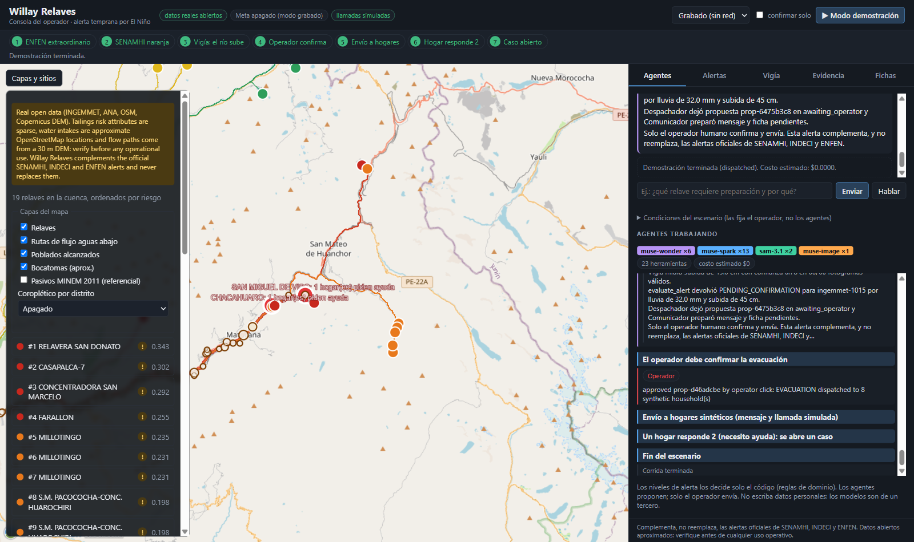

# Willay Relaves

An El Nino early-warning agent for Peru. It watches tailings sites (relaves) and the communities
downstream of them, and raises alerts on three horizons: weeks to months, 1 to 3 days, and hours.

Built for the Meta Global AI Developer Hackathon.

> **Honesty notes**
>
> - Willay Relaves **complements** the official SENAMHI, INDECI and ENFEN alerts. It **never replaces** them.
>   Every outgoing message says so and cites its official source.
> - **The LLM never decides an alert level.** Tiers come from deterministic rules in
>   `backend/willay/domain/tiers.py`. Language models may only rephrase or explain, and a rephrased
>   message is rejected (the template is used instead) if any required fact is missing.
> - **EVACUATION needs a human.** Without explicit operator confirmation the result is
>   `PENDING_CONFIRMATION`, never `EVACUATION`.
> - **Two data modes.** `WILLAY_DATA_MODE=real` (default) reads open datasets from `WILLAY_DATA_DIR`
>   (default `../willay-data`, never copied into this repo). `WILLAY_DATA_MODE=synthetic` uses the invented
>   fixtures in `backend/fixtures` (flagged `synthetic: true`; the test suite uses this mode).
> - **Real data is sparse and approximate**: tailings risk/status are blank for most sites (flagged
>   `data_quality`, neutral defaults), water intakes are approximate OpenStreetMap locations, flow paths come
>   from a 30 m DSM. See `docs/BACKTEST.md` for what the backtest can and cannot show.

## Alert tiers

| Tier | Horizon | Rule |
|------|---------|------|
| `PREPARATION` | weeks to months | ENFEN coastal El Nino magnitude >= strong AND seasonal rainfall anomaly forecast `above_normal` AND site static risk >= threshold |
| `ATTENTION` | 1 to 3 days | SENAMHI warning for the province is orange or red, OR forecast rain next 72 h >= threshold |
| `PENDING_CONFIRMATION` | hours | Evacuation conditions hold but no operator confirmation yet (operator-facing only) |
| `EVACUATION` | hours | Observed rain >= 20 mm in 24 h AND (measured water rise >= threshold from video segmentation OR a community watcher report) AND explicit operator confirmation |

ENFEN scale: neutral < weak < moderate < strong < extraordinary. All thresholds are configurable (`TierConfig`).

## Risk score

`risk = Trigger(t) x Susceptibility x TailingsVulnerability x DownstreamExposure`, each factor in [0, 1].

- A small configurable epsilon floor keeps a missing or zero factor from silently zeroing the score.
  The API returns the product and a per-factor breakdown (`raw`, `value`, `floored`, `missing`).
- **TailingsVulnerability**: log-normalized volume, status (abandoned is worst), declared risk level,
  distance to river (closer is worse).
- **DownstreamExposure**: settlements snapped to the downstream flow path (tolerance 500 m, haversine, no GIS
  libraries), weighted by `exp(-d / L)` (default L = 10 km), cutoff 50 km; population, households and drinking-water
  intakes raise the impact; impacts combine as a noisy-OR so the result saturates at 1.

## Real-data pipeline

Offline scripts (need numpy, shapely, tifffile from `requirements.txt`) write only to `willay-data/derived/`
(the backtest also reports an equal-weight rank-average ensemble of our score and the CENEPRED scenario, see `docs/BACKTEST.md`):

```bash
.venv/Scripts/python -I scripts/build_flowpaths.py          # D8 paths from the Copernicus DEM (flowpaths.geojson)
.venv/Scripts/python -I scripts/validate_flowpaths.py       # checks paths against IGN rivers
.venv/Scripts/python -I scripts/build_site_features.py      # susceptibility sample + distance to river
.venv/Scripts/python -I scripts/build_district_features.py  # static district features + simplified polygons
.venv/Scripts/python -I scripts/run_backtest.py             # derived/backtest_results.json
.venv/Scripts/python -I scripts/build_safe_points.py        # derived/safe_points.geojson (proposed safe points)
```

Unknown tailings status/risk map to `unknown` and use documented neutral defaults (0.7 / 0.5) plus a
`data_quality` flag. ANA population is `Pob_rev` (never the corrupted `Pob`). The CENEPRED 2027 scenario is
only a comparison baseline.

## Safe points (proposed, never official)

`scripts/build_safe_points.py` proposes one safe point per settlement with a deterministic rule
(`backend/willay/domain/safe_point.py`, pure and tested on tiny synthetic grids): the **nearest** cell of the
clipped Copernicus DEM that is (a) at least **30 m** above the nearest flow-path cell, (b) at least **300 m** from any
flow path, (c) within **2 km** in a straight line and (d) on a slope below **20 degrees**
(`--height --distance --radius --slope` override the defaults). Settlements without such a cell get none.

- A curated `safe_point` always wins. A proposed point is always worded "propuesto — validar con la municipalidad".
- Without any point the message says "Consulte a su municipalidad el punto seguro" (never "no definido").
- The output is `willay-data/derived/safe_points.geojson`; the API reads it at start-up in real mode.
- Caveats: 30 m DSM; "flow path" means only the D8 paths traced from the tailings sites, not every river; if no
  flow path lies within the search window nothing can be verified and no point is proposed.

## Alert loop and telephony

`POST /alerts/dispatch` (`site_id`, `tier`, `operator_confirmation_id` required for `EVACUATION`) messages every
**synthetic** demo household downstream of the site (`backend/fixtures/households_synthetic.json`) through
`MessagingPort`; the bundled `WebWhatsAppSimulator` only keeps the messages for the web phone mock-up. At
`ATTENTION` and `EVACUATION` it also calls each household through `CallPort`. Answers are `SAFE`, `NEEDS_HELP`,
`NO_ANSWER`; the last two open an operator case. Household messages are four short Spanish lines (situation, one
action, safe point, source). Phone numbers are masked in every response.

Calls are **simulated unless `WILLAY_CALLS_ENABLED=1` and Asterisk is configured**, and even then the adapter only
dials numbers in `WILLAY_CALL_ALLOWLIST`. Full setup (Asterisk snippets, recordings, what is unverified) is in
`docs/TELEPHONY.md`.

Environment variable NAMES for the alert loop (set values in your local `.env`; `.env.example` could not be edited by
the tooling that built this, so add them there yourself):

```
WILLAY_CALLS_ENABLED=0            WILLAY_CALL_ALLOWLIST=            ASTERISK_ARI_URL=
ASTERISK_ARI_USER=                ASTERISK_ARI_PASSWORD=            ASTERISK_TRUNK_NAME=
ASTERISK_ARI_APP=willay           WILLAY_CALL_DTMF_TIMEOUT_S=30     WILLAY_CALL_RING_TIMEOUT_S=30
WILLAY_CALL_SOUND_PREPARATION=    WILLAY_CALL_SOUND_ATTENTION=      WILLAY_CALL_SOUND_EVACUATION=
WILLAY_DEMO_HOUSEHOLDS_FILE=
```

## Alert languages

Household messages default to neutral professional Spanish (`es`); `en` is kept (operator messages default
to `en`). Other languages such as Quechua are **never machine-generated**: they need a human-reviewed template
file `backend/templates/reviewed/<lang>.json` (`WILLAY_REVIEWED_TEMPLATES_DIR` overrides the folder; format in
`willay/adapters/reviewed_templates.py`). Without it `/alerts/evaluate` returns the tier and
`message.available: false` with the reason.

## Backtest metrics

Pure functions with tests, no sklearn: ROC AUC (Mann-Whitney, ties count one half), top-k% capture rate,
lead time between the first PREPARATION alert and the emergency (median, p25, p75), and the false-alarm rate of
EVACUATION alerts (share of alerts not followed by an emergency).

## Architecture

Hexagonal, screaming structure. Dependencies point inward only (enforced by `test_architecture.py`).

```
backend/
  willay/
    domain/        entities, risk.py, tiers.py, exposure.py, backtest_metrics.py, geo.py, segmentation.py, water_line.py,
                   safe_point.py, dispatch.py (pure Python)
    application/   rank_sites, evaluate_alert_tier, compose_alert_message, run_backtest, operator_agent, enfen_ingest,
                   watch_clip, evacuation_card, judge_messages, dispatch_alerts, safe_point_text
    ports/         Protocols: SiteRepository, HazardData, Weather, Messaging, Calls, AlertLedger, LLM, Segmentation, Image, Transcription
    adapters/      in-memory fakes, fixture loader, meta_model_api (Responses/ASR/Image/SAM HTTP), meta_usage, clip_media,
                   asterisk_ari (telephony), simulated_call, web_whatsapp, alert_ledger, dem_window, safe_points_file
    api/           FastAPI app
  fixtures/        synthetic Rimac-basin and backtest JSON
  tests/           unit + api
web/               Vite + CesiumJS globe
```

## Run the backend

Requires Python 3.13.

```bash
python -m venv .venv
.venv/Scripts/python -m pip install -r requirements-dev.txt     # Windows
# source .venv/bin/activate && pip install -r requirements-dev.txt   # macOS/Linux

.venv/Scripts/python -m pytest                                   # run all tests (synthetic mode)

cd backend
../.venv/Scripts/python -m uvicorn willay.api.app:app --reload --port 8000
```

Endpoints (interactive docs at `http://localhost:8000/docs`):

| Method | Path | Purpose |
|--------|------|---------|
| GET | `/health` | liveness, `synthetic_data` flag |
| GET | `/sites?basin_only=&detail=` | basin sites ranked by risk: factor breakdown, `data_quality`, reached settlements/intakes |
| GET | `/sites/{id}` | one site: breakdown, reached settlements (name, population, distance_km), intakes, flow path GeoJSON, static inputs, current tier |
| GET | `/flowpaths` | all flow paths (GeoJSON, cumulative distance per vertex) |
| GET | `/districts` | district GeoJSON: static score, CENEPRED baseline, INDECI emergencies 2017/2023 |
| GET | `/layers/pasivos`, `/layers/intakes` | MINEM 2011 liabilities (secondary), approximate OSM intakes |
| POST | `/alerts/evaluate` | hazard inputs (+ `site_id` or `site_static_risk`, optional `language`) to tier, reasons and message |
| GET/POST | `/backtest?event=2017\|2023` | stored district backtest (synthetic mode: the synthetic fixture) |
| POST | `/agent/text`, `/agent/voice` | Spanish operator assistant (text, or WAV audio -> Voice Transcribe -> Muse Spark with tools); returns `{transcript, answer_es, ui_actions}` |
| POST | `/watch/clip` | river watcher: MP4/MOV (<= 15 s, no people) + marker height in cm -> SAM 3.1 -> `rise_cm`, confidence, overlays |
| POST | `/alerts/dispatch` | message (and at ATTENTION/EVACUATION call) the synthetic households downstream of a site; EVACUATION needs `operator_confirmation_id` |
| GET | `/alerts/households`, `/alerts/cases?status=` | household statuses (sent / SAFE / NEEDS_HELP / NO_ANSWER) and operator cases |
| POST | `/alerts/{id}/response` | a simulator reply (`SAFE`, `NEEDS_HELP`, `NO_ANSWER`); SAFE closes the open case |
| POST | `/agent/run`, GET `/agent/trace/{id}[/stream]`, GET `/agent/proposals`, POST `/agent/proposals/{id}/approve` | multi-agent orchestration, live trace and the operator's approval (see below) |
| POST | `/demo/run`, GET `/demo/status` | scripted end-to-end demo, offline or live |
| GET | `/learned-model`, `/enfen/timeline` | learned district model evaluation, ENFEN communique timeline |
| POST | `/telephony/twilio/gather` | signed Twilio key-press webhook (404 unless Twilio is the provider) |
| POST | `/cards/evacuation` | one Spanish evacuation card image for a SYNTHETIC household (tier from the domain rules) |

Example:

```bash
curl -X POST localhost:8000/alerts/evaluate -H "Content-Type: application/json" \
  -d '{"site_static_risk": 0.9, "observed_rain_24h_mm": 30, "water_rise_cm": 45}'
# -> "tier": "PENDING_CONFIRMATION"; add "operator_confirmed": true for EVACUATION
```

## Run the web app

Requires Node 20+. Start the backend first (port 8000; set `WILLAY_WEB_ORIGINS` to allow another web port).

```bash
cd web
npm install
npm run dev      # http://localhost:5173
npm run build    # type-check and production build
```

The globe is centered on the Rimac basin, uses OpenStreetMap imagery and an ellipsoid terrain (no Cesium ion
token needed). Points are colored by risk; selecting one shows the factor breakdown, current tier and
downstream settlements. Set `VITE_API_BASE_URL` to point at another backend.

## Meta model API (optional, live calls cost credits)

Copy `.env.example` to `.env` (never commit it) and set `META_API_KEY` (and optionally `META_API_BASE_URL`). The key is
loaded at runtime only, never printed, and redacted from errors. Nothing is wired unless `WILLAY_META_ENABLED=1`; without it
the `/agent`, `/watch` and `/cards` endpoints answer 503. The verified request contract (Responses API, Voice Transcribe,
Muse Image, SAM 3.1), prices and the list of things we could not verify are in `docs/META_API.md`.

- **Spend control**: every live call is appended to `<willay-data>/derived/meta_usage.jsonl` (model, tokens/frames/images/seconds,
  estimated cost; never prompts or media) and refused once the cumulative estimate would exceed `WILLAY_META_BUDGET_USD`
  (default 3.0).
- **Privacy**: free-credit content can be used by Meta. Send only public official documents, synthetic households and clips
  without people (`/watch/clip` requires `no_people_confirmed=true`, `/cards/evacuation` requires `synthetic_household=true`).
  We call only Standard-mode models.
- **The LLM never decides a tier.** The operator agent's tools call our use cases; `evaluate_alert` returns the tier from the domain
  rules, has no way to pass operator confirmation, and an answer that states a tier code no tool returned is replaced.
- **ENFEN ingestion**: `scripts/ingest_enfen.py --pdf <file> --live` has Muse Spark extract `{number, date, alert_status, Nino 1+2
  by month, Nino 3.4, rain outlook by region with verbatim quotes}` from a communique PDF. The curated `enfen_timeline.csv` wins
  on any mismatch (flag raised), a communique missing from the timeline is never used, and each rain outlook is re-derived from
  its quote by fixed rules and the quote must appear in the document text. A verified result feeds the seasonal rainfall outlook
  of the `HazardContext` (region "costa central"; `WILLAY_SEASONAL_ANOMALY` overrides it).
- **River watcher**: see `docs/WATCHER_PROTOCOL.md` (geometry, recording protocol, validation plan; accuracy on real water is
  unmeasured). Dry run: `scripts/make_synthetic_clip.py` then `scripts/watch_clip_cli.py`.
- **Muse Wonder judge**: `scripts/judge_messages.py --live` has Wonder score 10 composed Spanish messages (advisory; the code's
  fact check is authoritative). Results in `derived/message_judgements.json`.
- **Live smoke tests**: skipped by default. Run them once on purpose with `.venv/Scripts/python -m pytest -m live`.
  The normal suite uses mocked HTTP only and never calls the real API.

The web app has an operator assistant box (text or a microphone button; the browser records, converts to 16 kHz mono WAV and
posts it). The assistant moves the Cesium camera, highlights a site and its flow path and toggles layers through `ui_actions`.
Start the backend with `WILLAY_META_ENABLED=1` to use it.

## Operator console and Meta agents ("Meta at 100%")

One page, one console: the Cesium globe on the left (relaves, flow paths, safe points, intakes, district choropleth including the
learned model) and five tabs on the right, in Spanish for the operators.



| Tab | What it does |
|---|---|
| **Agentes** | Chat and microphone for the planner, plus a live timeline of every model call and tool call (agent, model badge `muse-wonder` / `muse-spark` / `sam-3.1` / `muse-image` / `voice-transcribe`, latency, tokens, estimated cost, guardrails). |
| **Alertas** | Dispatch proposals prepared by the agents, the operator's **Confirmar y enviar** button (needs an operator id), household statuses, the phone simulator and the open cases. |
| **Vigía** | Upload a clip (no people) -> SAM 3.1 overlays and `rise_cm`; or analyse the bundled fake clip offline. |
| **Evidencia** | Backtest AUC with bootstrap intervals (static, CENEPRED, ensembles, learned model), coefficients and calibration, the ENFEN timeline, data-quality flags. |
| **Fichas** | Muse Image evacuation card for a synthetic household (or the recorded one). |

**Demo mode** (top bar) runs the scripted scenario: ENFEN extraordinary -> PREPARATION ranking -> SENAMHI orange -> ATTENTION -> watcher
clip rise -> PENDING_CONFIRMATION -> **the operator confirms** -> dispatch -> a household answers 2 -> operator case. It is the real
orchestrator, tools, rules and guardrails in both modes: *Grabado* replays a recorded live run (`backend/fixtures/demo/`, no network,
no cost, marked "grabado" in the trace) and *Meta en vivo* (needs `WILLAY_META_ENABLED=1`) calls the models. The operator click is a real
click unless the "confirmar solo" box is ticked, which performs the same call and writes "simulated" in the trace. With real data no site
reaches the default PREPARATION threshold (0.5, the static risk tops out near 0.34), so the demo lowers it to 0.30 and says so in the trace.

### Multi-agent orchestration (Responses API)

`POST /agent/run` starts a **planner** (`muse-wonder-1.0`, falling back to `muse-spark-1.3` when Wonder errors, when the remaining budget
is low, or per call if it fails) that delegates through tools to four **specialists** (`muse-spark-1.3`): HazardAnalyst (ENFEN / CHIRPS /
SENAMHI context, ranking, backtest and learned-model explanations), Watcher (SAM 3.1 clip analysis), Dispatcher (prepares proposals) and
Communicator (Spanish messages, Muse Image cards; Quechua only from reviewed templates). `GET /agent/trace/{run_id}` returns the trace and
`GET /agent/trace/{run_id}/stream` streams it as Server-Sent Events. Hard guardrails in code (`application/orchestration/`):

- **Tiers only from the domain.** Agents cannot pass conditions: `evaluate_alert` reads the run's scenario (set by the operator or the demo)
  plus the clip measurement; an answer that cites a tier code no tool returned is replaced.
- **Nobody but the operator sends.** No agent has a send tool. `prepare_dispatch` creates a proposal; `POST /agent/proposals/{id}/approve`
  (the operator's click, with an operator id) re-evaluates the tier with that confirmation and only then dispatches. `EVACUATION` exists
  only as `PENDING_CONFIRMATION` until then.
- **Budget guard.** The existing usage log and `WILLAY_META_BUDGET_USD`, plus a per-run cap (`WILLAY_RUN_BUDGET_USD`).
- **No PII in the trace.** Arguments are summarised (ids and numbers only; free text becomes `<text N chars>`).

Environment variable NAMES added (set values in your local `.env`; `.env.example` is write-protected for the tooling that built this):

```
WILLAY_PLANNER_MODEL=muse-wonder-1.0         WILLAY_PLANNER_FALLBACK_MODEL=muse-spark-1.3
WILLAY_SPECIALIST_MODEL=muse-spark-1.3       WILLAY_PLANNER_MIN_BUDGET_USD=0.40
WILLAY_RUN_BUDGET_USD=0.75                   WILLAY_DEMO_PACE_S=0.6
WILLAY_WEB_ORIGINS=                          WILLAY_CALLS_PROVIDER=simulated
TWILIO_ACCOUNT_SID=  TWILIO_AUTH_TOKEN=  TWILIO_FROM_NUMBER=  WILLAY_PUBLIC_BASE_URL=
```

`WILLAY_SPECIALIST_MODEL` may name a `-contributor` variant (cheaper, content may train Meta models; only synthetic data is ever sent).
Transient Responses errors (429, 5xx, a response id not visible yet) are retried twice with backoff.

### Learned risk model

`scripts/train_risk_model.py` trains an L2 logistic regression on district features (train seasons 2003-2016, test 2017 and 2023). It does
**not** beat the a-priori static score (AUC 0.55 vs 0.93 in 2017, interval includes 0.5): see `docs/BACKTEST.md` for why (regime shift, no
deep learning on 78 districts) and for the table.

### Record the demo (once, costs credits)

`scripts/record_demo.py --live --yes-synthetic-only --budget 0.5` runs the demo against the real models and rewrites
`backend/fixtures/demo/orchestrator_recording.json` and `live_trace.json` (a real trace; synthetic clip and households only).

## Status

Real-data adapters for the INGEMMET tailings inventory, ANA settlements, OSM intakes, INDECI, CHIRPS and ENFEN
timeline are in place behind the existing ports, and the Meta Model API is wired for the operator agent, ENFEN
ingestion, the river watcher (contract confirmed, accuracy on real rivers not yet measured), evacuation cards and the
advisory judge. Not yet connected: live SENAMHI warnings and forecasts, SEDAPAL intake locations, ENFEN communique N°19.
